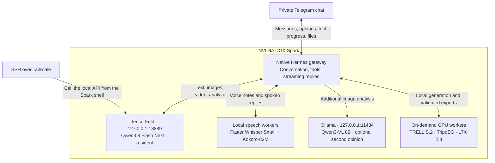

# DGX Spark Multimodal Setup

A single NVIDIA DGX Spark runs a private multimodal assistant you can reach from **Telegram** or a **shell over Tailscale**. Qwen3.8 Flash Next handles the conversation and reasoning. Local specialists give it speech input and output, a second vision model, textured 3D and mesh generation, and video generation.

Attach a photo and ask it to read a label. Send a voice note and get a spoken reply. Ask for timestamps on a video, or turn a reference photo into a textured GLB. These are ordinary messages in the private bot chat.

[Setup and smoke checks](SETUP.md) · [Hermes profile](hermes-native.yaml) · [Media plugin](hermes-plugins/spark-media/) · [ComfyUI workflows](workflows/)

## Architecture



**Hermes is the agent harness.** The systemd user service runs the native Telegram gateway with Hermes `v0.23.3`. Hermes manages dialogue, attachment handling, tool selection, and the tool progress and streaming edits you see in Telegram.

**TensorFold is the inference engine.** It keeps the NVIDIA Flash Next checkpoint loaded on the GB10 GPU and serves an OpenAI-compatible API on Spark loopback. The same model handles text, pixels, and sampled video frames. Terminal clients can call this API from a shell on the Spark.

**Specialists run on demand.** Ollama keeps the Qwen3-VL weights cached on disk and unloads the model after each fallback call. Speech runs in separate CPU processes. The media plugin admits one specialist GPU job at a time, stages it in its own work directory, and closes the worker when the job ends. Flash Next stays resident.

## What each model does

- **Chat, OCR, and video understanding — Qwen3.8 Flash Next.** Hermes passes image pixels directly for photo questions and OCR. For uploaded videos, Hermes's native `video_analyze` tool sends the clip to the same TensorFold server, whose local decoder samples frames for scene and timestamp questions. The result has the precision of the sampled frames.
- **Extra image analysis — Qwen3-VL 8B.** The media plugin can hand the latest photo to a second model through local Ollama when an image needs another pass.
- **Speech input — Faster Whisper Small.** Local CPU INT8 transcription turns a Telegram voice note into text for Flash Next.
- **Speech output — Kokoro-82M.** The CPU worker turns the answer into an English Opus voice bubble. Incoming voice notes get spoken replies by default. Typed messages get text replies.
- **Textured 3D — TRELLIS.2.** A native ComfyUI graph runs the INT8 model and its BF16 VAEs. The graph uses BiRefNet and the ComfyUI DINOv3 encoder, then exports a GLB with embedded material textures.
- **Geometry-only 3D — TripoSG.** An isolated GPU container runs the local TripoSG checkpoint when the request calls for an untextured mesh.
- **Video generation — LTX 2.3.** A separate ComfyUI workflow runs LTX 2.3 distilled FP8 to generate a short MP4. This is the path for creating footage. Uploaded-video questions go through Flash Next.

## What we built

- A **Spark-native Telegram deployment** with an owner-only profile, live tool progress, in-place reply streaming, Brave search integration, and automatic speech handling.
- A **media plugin** that remembers the latest verified photo in the private chat. A follow-up like “make a textured GLB from that photo” can use it directly. The plugin routes clear generation requests, then posts status and returns the finished asset in the chat.
- **Local worker wrappers** for speech, geometry, and ComfyUI. They limit input and output sizes, serialize specialist GPU jobs, validate exports, and use cached checkpoints. The ComfyUI worker runs with custom nodes disabled and publishes its job API on Spark loopback.
- **Versioned configuration and workflows** for the Hermes profile, systemd unit, and tested TRELLIS.2 and LTX 2.3 graphs. The [setup guide](SETUP.md) describes the runtime layout and how to check it. Runtime installation and model weights are staged separately.

## Serving configuration

Flash Next uses the `nvidia/Qwen3.8-Flash-Next-FP4-Local` checkpoint at revision `b9ce18a6887e18c089fdea8509a33e63429a3300`. The TensorFold image is `tensorfold-qwen38:v1.2.7-93a2e93` with FP8 KV cache, a 262,144-token context limit, and five server slots. The recipe starts with `VIDEO=1` for native video input. The media jobs use the `nvcr.io/nvidia/pytorch:26.07-py3` image and the tested ComfyUI revision in [SETUP.md](SETUP.md).

TensorFold listens on `127.0.0.1:18889`, Ollama on `127.0.0.1:11434`, and ComfyUI uses temporary loopback port `18193` during generation. Telegram provides transport for the private conversation and files. Brave handles web search when invoked. Model inference and media generation run on the Spark. The systemd profile reads its credentials on the host. The repository tracks code, configuration templates, and workflow definitions. Model weights, private profile data, and generated media stay on the host.

## What passed on the Spark

- **Telegram photo OCR and voice.** Flash Next read a known label from a photo. The bot transcribed a voice note with Faster Whisper and returned a Kokoro voice bubble.
- **Telegram textured 3D.** A natural-language follow-up delivered a GLB. Reopening the exact file confirmed 56,916 faces and three embedded 1024 × 1024 textures.
- **Telegram visual timestamps.** A plain caption selected `video_analyze` automatically. For cuts independently measured at 3.0 and 9.0 seconds, the bot returned ranges of 2.5–3.0 and 8.5–9.0 seconds. The analysis took about 18 seconds. The test verified visual events.
- **Local generation.** The TripoSG worker generated an untextured GLB, and the LTX 2.3 workflow generated a roughly five-second MP4. These worker checks ran on the Spark.
- **Direct remote access.** A fresh completion succeeded over SSH on Tailscale while the inference API was bound to Spark localhost.

Run the plugin's unit tests from the repo root:

```sh
python3 -B -m unittest -v test_spark_media
```
