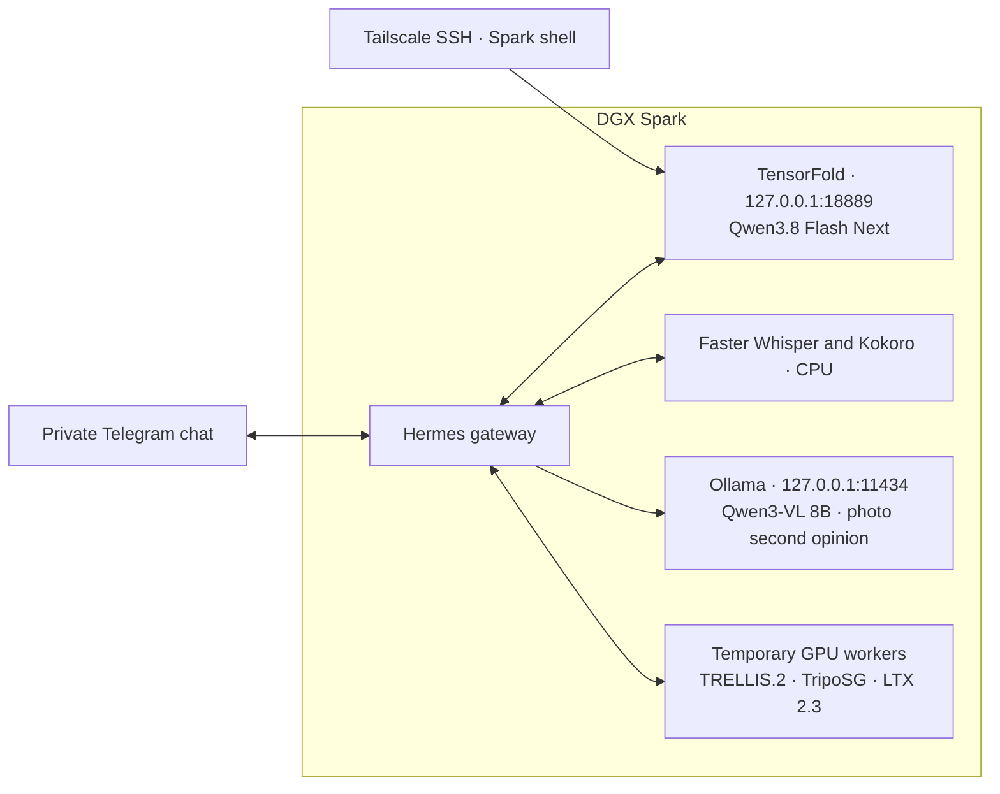

# DGX Spark setup

A single NVIDIA DGX Spark serves multimodal models for a private Telegram chat and a terminal over Tailscale. Hermes handles the conversation and tool calls. TensorFold keeps Qwen3.8 Flash Next loaded, and specialist workers load their models when needed.

## Running configuration

- **Chat, photos, OCR, and video understanding.** Flash Next uses the NVIDIA `Qwen3.8-Flash-Next-FP4-Local` checkpoint at revision `b9ce18a6887e18c089fdea8509a33e63429a3300`. The TensorFold image is `tensorfold-qwen38:v1.2.7-93a2e93`, with FP8 KV cache, a 262,144-token context limit, and five serving slots. Launch with `VIDEO=1` to load the bundled decoder used by Hermes's `video_analyze`.
- **Voice.** Faster Whisper Small runs in CPU INT8 and returns text to Hermes. Kokoro-82M speaks English replies for voice notes. The gateway sends the result as a Telegram voice bubble.
- **3D and video generation.** Native ComfyUI TRELLIS.2 produces textured GLBs. TripoSG produces geometry-only GLBs. LTX 2.3 distilled FP8 generates video. The plugin runs one specialist GPU job at a time and validates the exported file before delivery.
- **Network.** TensorFold and Ollama listen on Spark loopback. The temporary ComfyUI worker publishes `127.0.0.1:18193` for the job. Telegram handles delivery, and the Spark runs the inference. Brave is the configured web search backend.

## Repository contents

- [Hermes profile](hermes-native.yaml) and [systemd user unit](spark-hermes-telegram.service)
- [Media plugin and worker entry points](hermes-plugins/spark-media/)
- [ComfyUI workflow definitions](workflows/) for TRELLIS.2 and LTX 2.3
- [Runtime layout and smoke checks](SETUP.md)

The repository captures the gateway and worker configuration from the running host. Install the pinned inference runtime, Python environments, and model weights separately before activating the gateway. The live profile, Telegram credentials, SSH keys, cached uploads, and output files stay on the host.

## Verification

Run the media plugin's unit tests with `python3 -B -m unittest -v test_spark_media`. On the Spark, Telegram photo OCR, automatic voice replies, textured GLB delivery, and timestamped video analysis passed live tests. TripoSG and LTX 2.3 passed local worker tests. Timestamp ranges reflect sampled frames.
